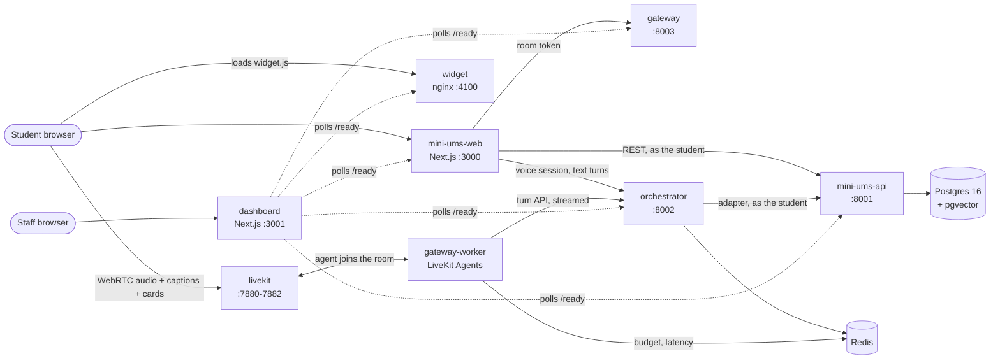

# Architecture

Status: **M3 (voice MVP)**. The Mini UMS is complete for M2; the voice pipeline answers one
Ask feature (attendance) by voice and by text. Design decisions are in
[decisions.md](decisions.md).

## Services

| Service | Role | Arrives |
|---|---|---|
| `db` | Postgres 16 + pgvector: Mini UMS data (and rulebook embeddings in M5) | M1 |
| `redis` | Voice sessions, daily budget, latency records (OTP TTLs, rate limits later) | M1, M3 |
| `livekit` | WebRTC media server (self-hosted dev mode locally) | M1 |
| `mini-ums-api` | Synthetic UMS: data API, auth, seed generator | M2 |
| `mini-ums-web` | Univra portal; embeds the widget; starts voice sessions server-side | M2, M3 |
| `orchestrator` | The agent: sessions, LangGraph graph, intent, replies, streaming turn API | M3 |
| `gateway` | Mints LiveKit room tokens and dispatches the agent worker | M3 |
| `gateway-worker` | VAD, end of turn, STT, TTS, barge-in, latency; calls the orchestrator | M3 |
| `widget` | Mic button, captions, cards, text input; one JS file | M3 |
| `dashboard` | Staff dashboard; today a live status page | M1, M6 |

## A voice turn

1. The widget asks its host page for a session (`POST /api/voice/session`). The Next.js route
   reads the httpOnly cookie, creates an orchestrator session holding the portal token, and
   asks the gateway for a LiveKit token. The browser only ever sees a session id and that
   room token (D-025).
2. The widget joins room `vs-<session>`; the token's dispatch brings the agent worker in.
3. Push-to-talk: the widget turns the mic on and calls the agent's `start_turn` RPC.
   Silero VAD ends the turn when the student stops talking (or they tap again: `end_turn`).
4. STT produces the transcript (live captions go to the widget). The worker sends it to the
   orchestrator, which classifies it, calls the Mini UMS API as the student, and streams back
   templated sentences and a card (D-029).
5. TTS speaks each sentence as it arrives; the card goes over the data channel.
6. Barge-in: speaking (or tapping the mic) during the reply interrupts it and cancels the
   orchestrator stream.
7. Timings per stage go to logs and Redis; `make latency` prints p50/p95.

Typed questions skip steps 2–5: the widget posts to `/api/voice/text`, which streams the
same orchestrator turn back.

## Boundaries that matter

- **Adapters.** The orchestrator never queries the database. It calls `mini-ums-api` through
  an adapter, as the student, so a real UMS could replace the Mini UMS without agent changes.
- **Identity.** The student comes only from the authenticated session (rule 1): the API takes
  it from the token, and no `/me` route accepts a student identifier (checked in the contract).
- **Providers.** STT, TTS and the LLM sit behind interfaces with a replay mode, and every paid
  call is checked against the daily budget first (D-028).
- **Untrusted text.** Transcripts never enter the system prompt and can't add tools (rule 6).

## Cross-cutting

- **Health:** `/health` = alive; `/ready` = dependencies reachable. Compose waits on `/ready`.
- **Logs:** one JSON object per line on stdout; IDs, phone numbers, OTPs and tokens are masked
  before writing (`libs/common`).
- **Config:** environment variables only; each service gets just the ones it needs.
