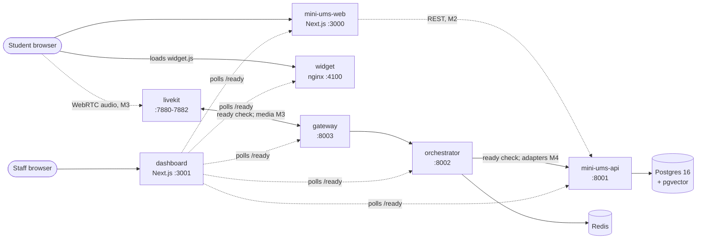

# Architecture

Status: **M1 (foundation)**. Services exist and talk to each other; features arrive in
later milestones. Design decisions are in [decisions.md](decisions.md).

## Services

Solid arrows are wired today (at least as readiness checks); dotted ones arrive in the
milestone shown.

| Service | Role | Depends on (ready check) | Arrives |
|---|---|---|---|
| `db` | Postgres 16 + pgvector: Mini UMS data and rulebook embeddings | — | M1 |
| `redis` | Session state, OTP TTLs, rate limits | — | M1 |
| `livekit` | WebRTC media server (self-hosted dev mode) | — | M1 |
| `mini-ums-api` | Synthetic UMS: data API, auth, seed generator | `db` + `vector` extension | M1 shell, M2 features |
| `orchestrator` | LangGraph agent, tools, guardrails, prompts | `redis`, `mini-ums-api` | M1 shell, M3–M4 |
| `gateway` | Realtime audio: STT → agent → TTS, VAD, barge-in | `orchestrator`, `livekit` | M1 shell, M3 |
| `widget` | Embeddable mic button and panel, one JS file | — | M1 shell, M3–M4 |
| `mini-ums-web` | Mini UMS front end; embeds the widget on every page | `mini-ums-api`, `widget` | M1 shell, M2 |
| `dashboard` | Staff dashboard; today a live status page | all of the above | M1 status, M6 |

## Boundaries that matter later

- **Adapters.** The orchestrator never queries the database. It calls `mini-ums-api`
  through adapter interfaces, so a real UMS could replace the Mini UMS without agent changes.
- **Identity.** `student_id` comes only from the authenticated session; the API rejects
  requests whose `student_id` doesn't match the token (rule 1, M2/M4).
- **Providers.** STT, TTS, LLM and tracing providers sit behind interfaces with a replay mode
  and a daily budget check (M3).

## Cross-cutting (M1)

- **Health:** `/health` = alive; `/ready` = dependencies reachable. Compose waits on `/ready`.
- **Logs:** one JSON object per line on stdout; IDs, phone numbers, OTPs and tokens are masked
  before writing (`libs/common`).
- **Config:** environment variables only; each service gets just the ones it needs.
